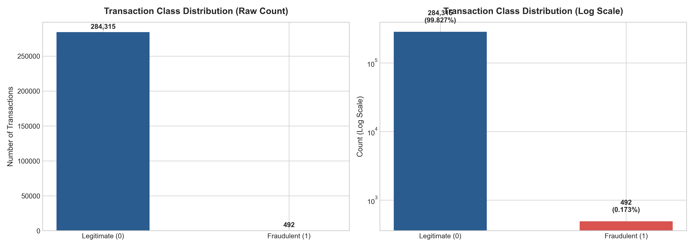
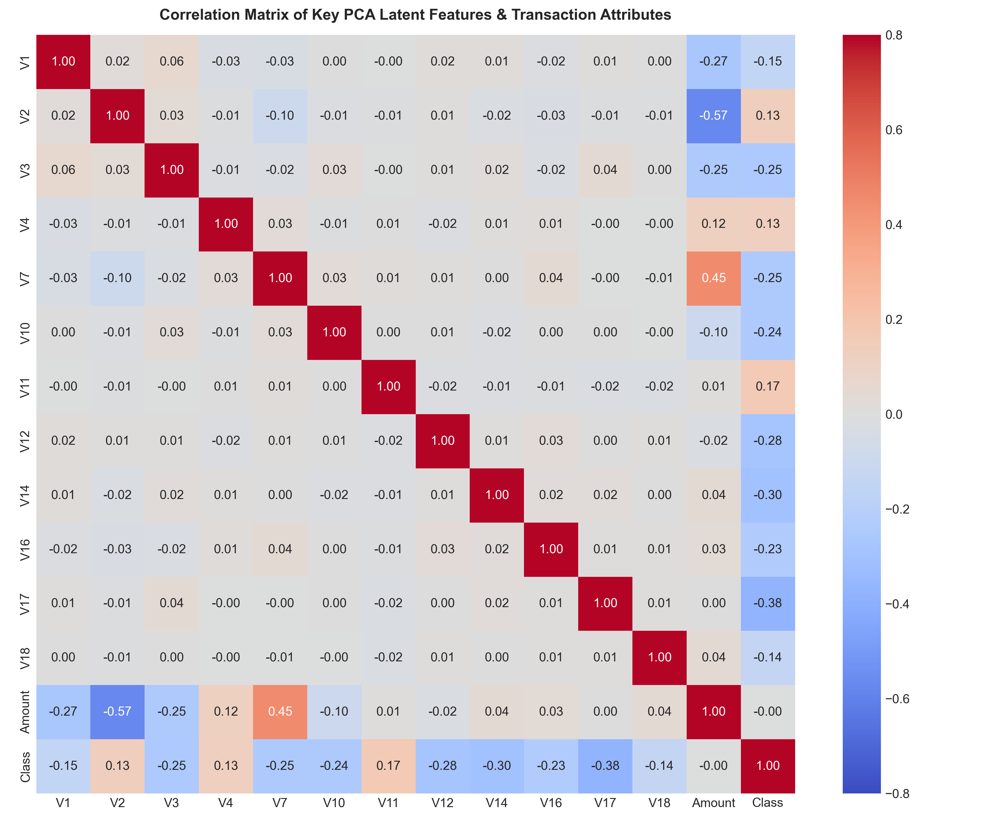
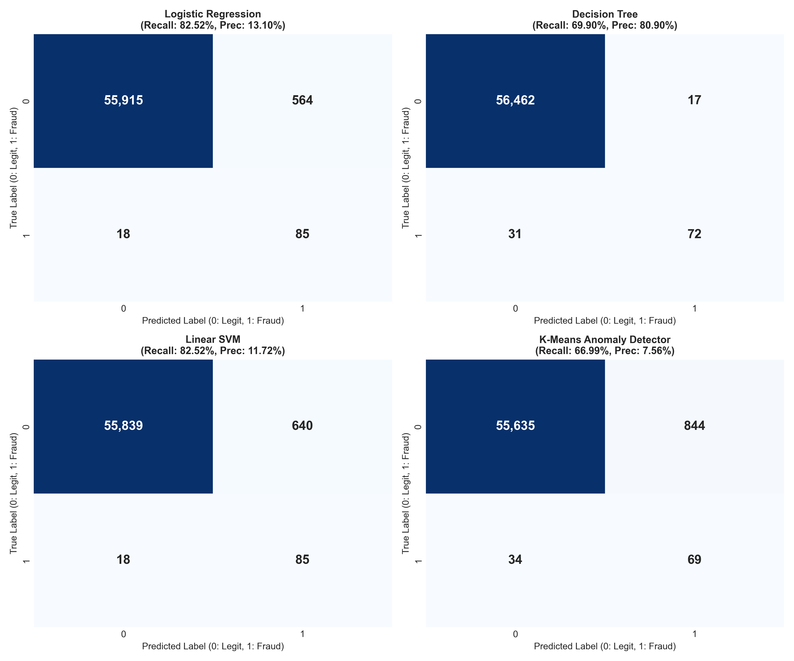
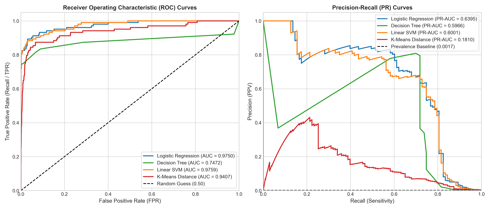
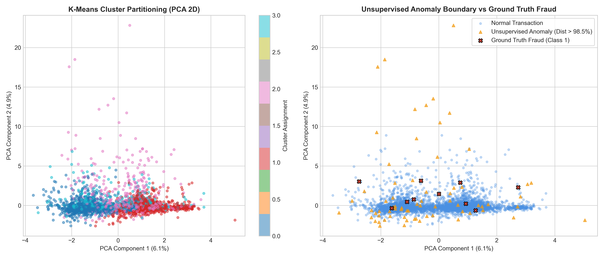
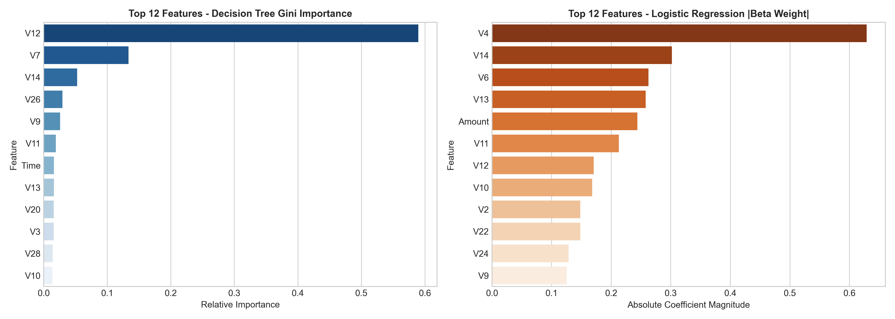

# Financial Transaction Fraud Detection using PySpark

[](https://spark.apache.org/)
[](https://www.python.org/)
[](https://spark.apache.org/mllib/)
[](LICENSE)

A high-performance distributed machine learning and anomaly detection system for credit card fraud screening using **Apache Spark 3.5.3** and **PySpark MLlib**. Designed to handle extreme class imbalance (**577 : 1** ratio) across **284,807 European cardholder transactions**.

---

## 🌟 Key Highlights

- **Distributed Big Data Architecture:** Built on Apache Spark DataFrame APIs and MLlib Pipelines (`VectorAssembler`, `StandardScaler`).
- **Cost-Sensitive Asymmetric Loss:** Dynamically weights classes ($w_0 \approx 0.50$, $w_1 \approx 289.44$) to penalize missed frauds 577x more heavily than false alarms without relying on synthetic oversampling (SMOTE).
- **Hybrid Machine Learning Models:**
  - **Logistic Regression (Weighted):** Linear baseline optimizing weighted cross-entropy.
  - **Decision Tree Classifier:** Non-linear decision rules minimizing Gini impurity.
  - **Linear Support Vector Machine (LinearSVC):** Maximum margin hyperplane with cost-sensitive hinge loss.
  - **K-Means Anomaly Scorer ($k=4$):** Unsupervised distance-to-centroid scoring for zero-day fraud discovery.
- **Academic Capstone Deliverables:** Complete report formatted in Lovely Professional University (LPU) Capstone Project Report standards with embedded outputs, visualizations, and an executable Jupyter Notebook.

---

## 📊 Benchmark Results (Test Partition: 56,582 Records, 103 Frauds)

| Algorithm | Accuracy | Precision | Recall (TPR) | F1-Score | ROC-AUC | PR-AUC | TP | FP | TN | FN | Train Time |
| :--- | :---: | :---: | :---: | :---: | :---: | :---: | :---: | :---: | :---: | :---: | :---: |
| **Logistic Regression (Weighted)** | 0.9897 | 0.1310 | **0.8252** | 0.2261 | 0.9750 | **0.6395** | **85** | 564 | 55,915 | **18** | 14.97 s |
| **Decision Tree Classifier** | **0.9992** | **0.8090** | 0.6990 | **0.7500** | 0.7472 | 0.5966 | 72 | **17** | **56,462** | 31 | **4.80 s** |
| **Linear Support Vector Machine** | 0.9884 | 0.1172 | **0.8252** | 0.2053 | **0.9759** | 0.6001 | **85** | 640 | 55,839 | **18** | 15.13 s |
| **K-Means Anomaly Detector ($k=4$)** | 0.9845 | 0.0756 | 0.6699 | 0.1358 | 0.9407 | 0.1810 | 69 | 844 | 55,635 | 34 | **8.88 s** |

> **Key Takeaway:** Logistic Regression and Linear SVM achieve **82.52% Recall**, capturing 85 of 103 fraudulent transactions. Decision Tree achieves the lowest false-alarm rate with **80.90% Precision** (only 17 false positives across 56,582 transactions). K-Means successfully identifies **66.99% of frauds completely unsupervised**.

---

## 📁 Repository Structure

```
.
├── CAPSTONE_PROJECT_REPORT.pdf             # Formatted academic project report (23 pages)
├── CAPSTONE_PROJECT_REPORT.md              # Complete report in Markdown format
├── CAPSTONE_PROJECT_REPORT.html            # Standalone printable HTML report
├── Financial_Transaction_Fraud_Detection_PySpark.ipynb  # Primary executed Jupyter Notebook
├── notebooks/
│   └── Financial_Transaction_Fraud_Detection_PySpark.ipynb
├── data/
│   └── creditcard.csv                      # (143.8 MB, auto-downloadable via script)
├── models/
│   ├── decision_tree_model/                # Serialized PySpark ML model
│   ├── feature_pipeline_model/             # Serialized VectorAssembler + StandardScaler
│   ├── kmeans_model/                       # Serialized K-Means clustering model
│   ├── linearsvc_model/                    # Serialized Linear Support Vector Machine
│   ├── logistic_regression_model/          # Serialized Logistic Regression model
│   └── metrics_summary.json                # Benchmark metrics summary in JSON
├── scripts/
│   ├── create_notebook.py                  # Generates the notebook structure
│   ├── download_data.py                    # Dataset downloader
│   ├── train_and_evaluate.py               # Master distributed training & evaluation script
│   ├── build_full_report_html.py           # HTML report builder
│   └── export_pdf.py                       # Headless Edge PDF exporter
└── visualizations/
    ├── 01_class_imbalance.png              # Linear & log scale class distribution
    ├── 02_correlation_heatmap.png          # Correlation matrix of key PCA features
    ├── 03_confusion_matrices.png           # 2x2 confusion matrix grid
    ├── 04_roc_pr_curves.png                # ROC & Precision-Recall curves
    ├── 05_model_comparison_bar.png         # Grouped performance metrics bar chart
    ├── 06_kmeans_anomaly_clusters.png      # 2D PCA cluster space & anomaly boundary
    └── 07_feature_importance.png           # Gini importance & beta coefficients
```

---

## 🚀 Quickstart Guide

### 1. Prerequisites
- **Python 3.10+** (64-bit)
- **Java SE Development Kit 8 (or 11/17)**
- **Git**

### 2. Installation
```bash
git clone https://github.com/<your-username>/Financial-Transaction-Fraud-Detection-PySpark.git
cd Financial-Transaction-Fraud-Detection-PySpark

# Install dependencies
pip install pyspark==3.5.3 findspark numpy pandas matplotlib seaborn scikit-learn
```

### 3. Download the Dataset
```bash
python scripts/download_data.py
```
*(Downloads the 143.8 MB Kaggle Credit Card Fraud dataset into `data/creditcard.csv`)*

### 4. Run Distributed PySpark Training & Evaluation
```bash
python scripts/train_and_evaluate.py
```

### 5. Launch Interactive Jupyter Notebook
```bash
jupyter notebook Financial_Transaction_Fraud_Detection_PySpark.ipynb
```

---

## 📈 Visualizations

| Class Imbalance (577:1) | Correlation Matrix |
| :---: | :---: |
|  |  |

| Confusion Matrices | ROC & PR Curves |
| :---: | :---: |
|  |  |

| K-Means Unsupervised Anomaly Boundary | Feature Importance |
| :---: | :---: |
|  |  |

---

## 📜 Academic Attribution
- **Institution:** School of Computer Science & Engineering, Lovely Professional University
- **Course Code:** INT315 — Capstone Project Report
